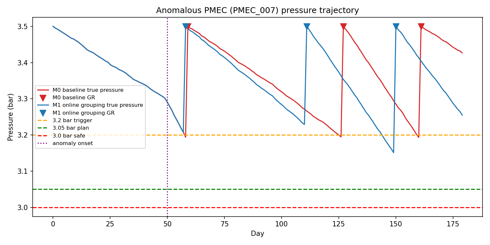
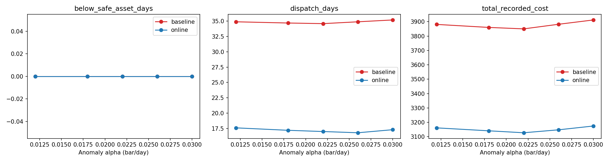

# 异常 PMEC 情景下在线 GR 分组方法验证报告

## 1. 实验目的

本实验旨在验证：当某一台 PMEC 出现突发泄漏加速（异常）时，基于在线 Kalman 状态估计、B0 概率安全约束与 MILP 任务组合的维护策略（M1），相较于传统的“压力达到 3.2 bar 即触发 GR”响应式策略（M0），能否在降低低压风险的同时减少紧急出勤并保持任务组合效率。

## 2. 系统与异常模型

- PMEC 数量：12 台，仿真天数：180 天。
- 正常泄漏率范围：0.004–0.009 bar/day。
- 异常 PMEC：anomaly_validation/results_full/config.json 中 `anomaly_asset_index` 对应的设备，异常起始日：第 50 天，异常泄漏率：0.03 bar/day，渐变天数：0 天。
- 异常持续到该 PMEC 的下一次 GR；GR 后泄漏率恢复为正常抽样。
- 压力阈值：触发 3.2 bar，计划 3.05 bar，安全 3.0 bar；GR 后压力重置为 3.5 bar。

## 3. 被比较策略

| 策略 | 决策规则 | 说明 |
|---|---|---|
| M0 基线 | 滤波均值 ≤ 3.2 bar 即触发，安排最早安全可行日执行，容量不足则排队 | 响应式，无前瞻 |
| M1 在线分组 | 每日更新 Kalman，预测均值接近 3.2 bar 或 B0 下界接近 3.05 bar 时创建任务，MILP 组合排程 | 前瞻、风险感知、可组合 |

## 4. 实验设计

- 异常幅度扫描：[0.012, 0.018, 0.022, 0.026, 0.03] bar/day。
- 异常起始日固定为第 50 天。
- 每个情景 × 每个策略运行 10 个随机种子（配对比较）。
- 所有策略共享相同的初始条件、观测噪声、缺测概率、GR 重置规则与容量约束。
- 容量约束：每日最多 4 次 GR。

## 5. 评价指标

| 类别 | 指标 | 定义 |
|---|---|---|
| 安全 | below_safe_asset_days | 真实压力低于 3.0 bar 的设备—日数 |
| 安全 | below_plan_asset_days | 真实压力低于 3.05 bar 的设备—日数 |
| 安全 | min_true_pressure | 全期真实压力最低值 |
| 及时性 | anomaly_detection_lead | 方法首次创建/触发异常任务日 − 异常开始日 |
| 及时性 | anomaly_gr_lead | 异常 PMEC 的 GR 执行日 − 异常开始日 |
| 经济 | dispatch_days | 实际出勤日期数 |
| 经济 | setup_cost | 出勤次数 × 单次出勤成本 |
| 经济 | executed_shift_penalty | 实际执行日相对名义参考日的早晚惩罚 |
| 经济 | total_recorded_cost | setup 成本 + 移动惩罚 |
| 组合 | tasks_per_dispatch | 每次出勤平均完成的 GR 数 |
| 稳健性 | emergency_gr_count | 因无安全可行日而被迫紧急执行的 GR 数 |
| 算法 | solver 次数/耗时 | MILP 调用次数与总耗时（仅 M1） |

## 6. 实验结果

### 6.1 聚合结果（各情景 × 策略，跨种子均值）

| strategy   |   seed | status    | message   |   anomaly_alpha |   anomaly_start_day | anomaly_asset   |   executed_tasks |   dispatch_days |   setup_cost |   below_safe_asset_days |   below_plan_asset_days |   min_true_pressure |   total_recorded_cost |   executed_shift_penalty |   anomaly_gr_day |   anomaly_gr_count |   anomaly_detection_day |   anomaly_detection_lead |   anomaly_gr_lead |   emergency_gr_count |   tasks_per_dispatch |
|:-----------|-------:|:----------|:----------|----------------:|--------------------:|:----------------|-----------------:|----------------:|-------------:|------------------------:|------------------------:|--------------------:|----------------------:|-------------------------:|-----------------:|-------------------:|------------------------:|-------------------------:|------------------:|---------------------:|---------------------:|
| baseline   |      0 | completed |           |           0.012 |                  50 | PMEC_007        |               38 |              32 |         3200 |                       0 |                       0 |             3.18124 |                  3580 |                      380 |               59 |                  3 |                      58 |                        8 |                 9 |                    0 |              1.1875  |
| online     |      0 | completed |           |           0.012 |                  50 | PMEC_007        |               44 |              17 |         1700 |                       0 |                       0 |             3.10617 |                  2910 |                     1210 |               58 |                  3 |                      71 |                       21 |                 8 |                    0 |              2.58824 |
| baseline   |      1 | completed |           |           0.012 |                  50 | PMEC_007        |               40 |              34 |         3400 |                       0 |                       0 |             3.18229 |                  3800 |                      400 |               59 |                  3 |                      58 |                        8 |                 9 |                    0 |              1.17647 |
| online     |      1 | completed |           |           0.012 |                  50 | PMEC_007        |               45 |              18 |         1800 |                       0 |                       0 |             3.14175 |                  3150 |                     1350 |               58 |                  3 |                      64 |                       14 |                 8 |                    0 |              2.5     |
| baseline   |      2 | completed |           |           0.012 |                  50 | PMEC_007        |               36 |              32 |         3200 |                       0 |                       0 |             3.1874  |                  3560 |                      360 |               60 |                  3 |                      59 |                        9 |                10 |                    0 |              1.125   |
| online     |      2 | completed |           |           0.012 |                  50 | PMEC_007        |               44 |              17 |         1700 |                       0 |                       0 |             3.10382 |                  2950 |                     1250 |               66 |                  3 |                      82 |                       32 |                16 |                    0 |              2.58824 |
| baseline   |      3 | completed |           |           0.012 |                  50 | PMEC_007        |               41 |              38 |         3800 |                       0 |                       0 |             3.18516 |                  4210 |                      410 |               59 |                  3 |                      58 |                        8 |                 9 |                    0 |              1.07895 |
| online     |      3 | completed |           |           0.012 |                  50 | PMEC_007        |               43 |              16 |         1600 |                       0 |                       0 |             3.15374 |                  3235 |                     1635 |               40 |                  4 |                      80 |                       30 |               -10 |                    0 |              2.6875  |
| baseline   |      4 | completed |           |           0.012 |                  50 | PMEC_007        |               40 |              36 |         3600 |                       0 |                       0 |             3.18046 |                  4000 |                      400 |               59 |                  3 |                      58 |                        8 |                 9 |                    0 |              1.11111 |
| online     |      4 | completed |           |           0.012 |                  50 | PMEC_007        |               43 |              19 |         1900 |                       0 |                       0 |             3.1244  |                  3360 |                     1460 |               40 |                  3 |                      64 |                       14 |               -10 |                    0 |              2.26316 |
| baseline   |      5 | completed |           |           0.012 |                  50 | PMEC_007        |               39 |              35 |         3500 |                       0 |                       0 |             3.18678 |                  3890 |                      390 |               59 |                  3 |                      58 |                        8 |                 9 |                    0 |              1.11429 |
| online     |      5 | completed |           |           0.012 |                  50 | PMEC_007        |               44 |              16 |         1600 |                       0 |                       0 |             3.13731 |                  3155 |                     1555 |               50 |                  4 |                      53 |                        3 |                 0 |                    0 |              2.75    |
| baseline   |      6 | completed |           |           0.012 |                  50 | PMEC_007        |               40 |              36 |         3600 |                       0 |                       0 |             3.1813  |                  4000 |                      400 |               59 |                  2 |                      58 |                        8 |                 9 |                    0 |              1.11111 |
| online     |      6 | completed |           |           0.012 |                  50 | PMEC_007        |               44 |              16 |         1600 |                       0 |                       0 |             3.17019 |                  2670 |                     1070 |               59 |                  3 |                      71 |                       21 |                 9 |                    0 |              2.75    |
| baseline   |      7 | completed |           |           0.012 |                  50 | PMEC_007        |               39 |              36 |         3600 |                       0 |                       0 |             3.18744 |                  3990 |                      390 |               60 |                  3 |                      59 |                        9 |                10 |                    0 |              1.08333 |
| online     |      7 | completed |           |           0.012 |                  50 | PMEC_007        |               45 |              19 |         1900 |                       0 |                       0 |             3.14927 |                  3300 |                     1400 |               60 |                  3 |                      63 |                       13 |                10 |                    0 |              2.36842 |
| baseline   |      8 | completed |           |           0.012 |                  50 | PMEC_007        |               37 |              30 |         3000 |                       0 |                       0 |             3.17737 |                  3370 |                      370 |               61 |                  3 |                      60 |                       10 |                11 |                    0 |              1.23333 |
| online     |      8 | completed |           |           0.012 |                  50 | PMEC_007        |               42 |              16 |         1600 |                       0 |                       0 |             3.13177 |                  3160 |                     1560 |               62 |                  3 |                      71 |                       21 |                12 |                    0 |              2.625   |
| baseline   |      9 | completed |           |           0.012 |                  50 | PMEC_007        |               41 |              40 |         4000 |                       0 |                       0 |             3.18143 |                  4410 |                      410 |               60 |                  3 |                      59 |                        9 |                10 |                    0 |              1.025   |
| online     |      9 | completed |           |           0.012 |                  50 | PMEC_007        |               42 |              22 |         2200 |                       0 |                       0 |             3.10878 |                  3725 |                     1525 |               67 |                  3 |                      87 |                       37 |                17 |                    0 |              1.90909 |
| baseline   |      0 | completed |           |           0.018 |                  50 | PMEC_007        |               38 |              32 |         3200 |                       0 |                       0 |             3.1768  |                  3580 |                      380 |               57 |                  3 |                      56 |                        6 |                 7 |                    0 |              1.1875  |
| online     |      0 | completed |           |           0.018 |                  50 | PMEC_007        |               44 |              17 |         1700 |                       0 |                       0 |             3.10617 |                  2910 |                     1210 |               58 |                  3 |                      71 |                       21 |                 8 |                    0 |              2.58824 |
| baseline   |      1 | completed |           |           0.018 |                  50 | PMEC_007        |               41 |              34 |         3400 |                       0 |                       0 |             3.18229 |                  3810 |                      410 |               56 |                  4 |                      55 |                        5 |                 6 |                    0 |              1.20588 |
| online     |      1 | completed |           |           0.018 |                  50 | PMEC_007        |               45 |              18 |         1800 |                       0 |                       0 |             3.14175 |                  3150 |                     1350 |               58 |                  3 |                      64 |                       14 |                 8 |                    0 |              2.5     |
| baseline   |      2 | completed |           |           0.018 |                  50 | PMEC_007        |               36 |              31 |         3100 |                       0 |                       0 |             3.18324 |                  3460 |                      360 |               57 |                  3 |                      56 |                        6 |                 7 |                    0 |              1.16129 |
| online     |      2 | completed |           |           0.018 |                  50 | PMEC_007        |               43 |              18 |         1800 |                       0 |                       0 |             3.09887 |                  2935 |                     1135 |               62 |                  3 |                      69 |                       19 |                12 |                    0 |              2.38889 |
| baseline   |      3 | completed |           |           0.018 |                  50 | PMEC_007        |               41 |              38 |         3800 |                       0 |                       0 |             3.18583 |                  4210 |                      410 |               56 |                  3 |                      55 |                        5 |                 6 |                    0 |              1.07895 |
| online     |      3 | completed |           |           0.018 |                  50 | PMEC_007        |               43 |              16 |         1600 |                       0 |                       0 |             3.15374 |                  3235 |                     1635 |               40 |                  4 |                      80 |                       30 |               -10 |                    0 |              2.6875  |
| baseline   |      4 | completed |           |           0.018 |                  50 | PMEC_007        |               39 |              34 |         3400 |                       0 |                       0 |             3.16785 |                  3790 |                      390 |               57 |                  3 |                      56 |                        6 |                 7 |                    0 |              1.14706 |
| online     |      4 | completed |           |           0.018 |                  50 | PMEC_007        |               43 |              19 |         1900 |                       0 |                       0 |             3.1244  |                  3360 |                     1460 |               40 |                  3 |                      64 |                       14 |               -10 |                    0 |              2.26316 |
| baseline   |      5 | completed |           |           0.018 |                  50 | PMEC_007        |               39 |              36 |         3600 |                       0 |                       0 |             3.17517 |                  3990 |                      390 |               57 |                  3 |                      56 |                        6 |                 7 |                    0 |              1.08333 |
| online     |      5 | completed |           |           0.018 |                  50 | PMEC_007        |               44 |              16 |         1600 |                       0 |                       0 |             3.13731 |                  3155 |                     1555 |               50 |                  4 |                      53 |                        3 |                 0 |                    0 |              2.75    |
| baseline   |      6 | completed |           |           0.018 |                  50 | PMEC_007        |               41 |              37 |         3700 |                       0 |                       0 |             3.17434 |                  4110 |                      410 |               57 |                  3 |                      56 |                        6 |                 7 |                    0 |              1.10811 |
| online     |      6 | completed |           |           0.018 |                  50 | PMEC_007        |               43 |              16 |         1600 |                       0 |                       0 |             3.11996 |                  2735 |                     1135 |               60 |                  3 |                      81 |                       31 |                10 |                    0 |              2.6875  |
| baseline   |      7 | completed |           |           0.018 |                  50 | PMEC_007        |               39 |              36 |         3600 |                       0 |                       0 |             3.18729 |                  3990 |                      390 |               57 |                  3 |                      56 |                        6 |                 7 |                    0 |              1.08333 |
| online     |      7 | completed |           |           0.018 |                  50 | PMEC_007        |               44 |              16 |         1600 |                       0 |                       0 |             3.14927 |                  2980 |                     1380 |               59 |                  2 |                      93 |                       43 |                 9 |                    0 |              2.75    |
| baseline   |      8 | completed |           |           0.018 |                  50 | PMEC_007        |               36 |              30 |         3000 |                       0 |                       0 |             3.18224 |                  3360 |                      360 |               57 |                  2 |                      56 |                        6 |                 7 |                    0 |              1.2     |
| online     |      8 | completed |           |           0.018 |                  50 | PMEC_007        |               42 |              16 |         1600 |                       0 |                       0 |             3.09327 |                  3320 |                     1720 |               62 |                  3 |                      71 |                       21 |                12 |                    0 |              2.625   |
| baseline   |      9 | completed |           |           0.018 |                  50 | PMEC_007        |               40 |              39 |         3900 |                       0 |                       0 |             3.18143 |                  4300 |                      400 |               57 |                  2 |                      56 |                        6 |                 7 |                    0 |              1.02564 |
| online     |      9 | completed |           |           0.018 |                  50 | PMEC_007        |               42 |              20 |         2000 |                       0 |                       0 |             3.1351  |                  3630 |                     1630 |               55 |                  3 |                      66 |                       16 |                 5 |                    0 |              2.1     |
| baseline   |      0 | completed |           |           0.022 |                  50 | PMEC_007        |               38 |              32 |         3200 |                       0 |                       0 |             3.17147 |                  3580 |                      380 |               56 |                  3 |                      55 |                        5 |                 6 |                    0 |              1.1875  |
| online     |      0 | completed |           |           0.022 |                  50 | PMEC_007        |               44 |              17 |         1700 |                       0 |                       0 |             3.10617 |                  2910 |                     1210 |               58 |                  3 |                      71 |                       21 |                 8 |                    0 |              2.58824 |
| baseline   |      1 | completed |           |           0.022 |                  50 | PMEC_007        |               41 |              33 |         3300 |                       0 |                       0 |             3.18229 |                  3710 |                      410 |               55 |                  4 |                      54 |                        4 |                 5 |                    0 |              1.24242 |
| online     |      1 | completed |           |           0.022 |                  50 | PMEC_007        |               45 |              18 |         1800 |                       0 |                       0 |             3.11905 |                  3150 |                     1350 |               58 |                  3 |                      64 |                       14 |                 8 |                    0 |              2.5     |
| baseline   |      2 | completed |           |           0.022 |                  50 | PMEC_007        |               36 |              32 |         3200 |                       0 |                       0 |             3.17888 |                  3560 |                      360 |               56 |                  3 |                      55 |                        5 |                 6 |                    0 |              1.125   |
| online     |      2 | completed |           |           0.022 |                  50 | PMEC_007        |               44 |              15 |         1500 |                       0 |                       0 |             3.09457 |                  3085 |                     1585 |               60 |                  3 |                      69 |                       19 |                10 |                    0 |              2.93333 |
| baseline   |      3 | completed |           |           0.022 |                  50 | PMEC_007        |               41 |              38 |         3800 |                       0 |                       0 |             3.1849  |                  4210 |                      410 |               55 |                  3 |                      54 |                        4 |                 5 |                    0 |              1.07895 |
| online     |      3 | completed |           |           0.022 |                  50 | PMEC_007        |               43 |              16 |         1600 |                       0 |                       0 |             3.15374 |                  3235 |                     1635 |               40 |                  4 |                      80 |                       30 |               -10 |                    0 |              2.6875  |
| baseline   |      4 | completed |           |           0.022 |                  50 | PMEC_007        |               38 |              34 |         3400 |                       0 |                       0 |             3.16163 |                  3780 |                      380 |               56 |                  2 |                      55 |                        5 |                 6 |                    0 |              1.11765 |
| online     |      4 | completed |           |           0.022 |                  50 | PMEC_007        |               43 |              19 |         1900 |                       0 |                       0 |             3.1244  |                  3360 |                     1460 |               40 |                  3 |                      64 |                       14 |               -10 |                    0 |              2.26316 |
| baseline   |      5 | completed |           |           0.022 |                  50 | PMEC_007        |               39 |              36 |         3600 |                       0 |                       0 |             3.17064 |                  3990 |                      390 |               56 |                  3 |                      55 |                        5 |                 6 |                    0 |              1.08333 |
| online     |      5 | completed |           |           0.022 |                  50 | PMEC_007        |               44 |              16 |         1600 |                       0 |                       0 |             3.13731 |                  3155 |                     1555 |               50 |                  4 |                      53 |                        3 |                 0 |                    0 |              2.75    |
| baseline   |      6 | completed |           |           0.022 |                  50 | PMEC_007        |               40 |              35 |         3500 |                       0 |                       0 |             3.16866 |                  3900 |                      400 |               56 |                  2 |                      55 |                        5 |                 6 |                    0 |              1.14286 |
| online     |      6 | completed |           |           0.022 |                  50 | PMEC_007        |               44 |              16 |         1600 |                       0 |                       0 |             3.09989 |                  2670 |                     1070 |               59 |                  3 |                      71 |                       21 |                 9 |                    0 |              2.75    |
| baseline   |      7 | completed |           |           0.022 |                  50 | PMEC_007        |               39 |              36 |         3600 |                       0 |                       0 |             3.18342 |                  3990 |                      390 |               56 |                  3 |                      55 |                        5 |                 6 |                    0 |              1.08333 |
| online     |      7 | completed |           |           0.022 |                  50 | PMEC_007        |               44 |              16 |         1600 |                       0 |                       0 |             3.11713 |                  2980 |                     1380 |               59 |                  2 |                      93 |                       43 |                 9 |                    0 |              2.75    |
| baseline   |      8 | completed |           |           0.022 |                  50 | PMEC_007        |               37 |              31 |         3100 |                       0 |                       0 |             3.17675 |                  3470 |                      370 |               56 |                  3 |                      55 |                        5 |                 6 |                    0 |              1.19355 |
| online     |      8 | completed |           |           0.022 |                  50 | PMEC_007        |               41 |              17 |         1700 |                       0 |                       0 |             3.08893 |                  3100 |                     1400 |               60 |                  3 |                      72 |                       22 |                10 |                    0 |              2.41176 |
| baseline   |      9 | completed |           |           0.022 |                  50 | PMEC_007        |               41 |              39 |         3900 |                       0 |                       0 |             3.17838 |                  4310 |                      410 |               56 |                  3 |                      55 |                        5 |                 6 |                    0 |              1.05128 |
| online     |      9 | completed |           |           0.022 |                  50 | PMEC_007        |               42 |              20 |         2000 |                       0 |                       0 |             3.1351  |                  3630 |                     1630 |               55 |                  3 |                      66 |                       16 |                 5 |                    0 |              2.1     |
| baseline   |      0 | completed |           |           0.026 |                  50 | PMEC_007        |               38 |              32 |         3200 |                       0 |                       0 |             3.17298 |                  3580 |                      380 |               55 |                  3 |                      54 |                        4 |                 5 |                    0 |              1.1875  |
| online     |      0 | completed |           |           0.026 |                  50 | PMEC_007        |               44 |              17 |         1700 |                       0 |                       0 |             3.0958  |                  2910 |                     1210 |               58 |                  3 |                      71 |                       21 |                 8 |                    0 |              2.58824 |
| baseline   |      1 | completed |           |           0.026 |                  50 | PMEC_007        |               41 |              33 |         3300 |                       0 |                       0 |             3.16523 |                  3710 |                      410 |               55 |                  4 |                      54 |                        4 |                 5 |                    0 |              1.24242 |
| online     |      1 | completed |           |           0.026 |                  50 | PMEC_007        |               45 |              18 |         1800 |                       0 |                       0 |             3.08705 |                  3150 |                     1350 |               58 |                  3 |                      64 |                       14 |                 8 |                    0 |              2.5     |
| baseline   |      2 | completed |           |           0.026 |                  50 | PMEC_007        |               36 |              32 |         3200 |                       0 |                       0 |             3.15488 |                  3560 |                      360 |               56 |                  3 |                      55 |                        5 |                 6 |                    0 |              1.125   |
| online     |      2 | completed |           |           0.026 |                  50 | PMEC_007        |               44 |              15 |         1500 |                       0 |                       0 |             3.07996 |                  3180 |                     1680 |               59 |                  3 |                      76 |                       26 |                 9 |                    0 |              2.93333 |
| baseline   |      3 | completed |           |           0.026 |                  50 | PMEC_007        |               41 |              38 |         3800 |                       0 |                       0 |             3.1649  |                  4210 |                      410 |               55 |                  3 |                      54 |                        4 |                 5 |                    0 |              1.07895 |
| online     |      3 | completed |           |           0.026 |                  50 | PMEC_007        |               43 |              16 |         1600 |                       0 |                       0 |             3.15374 |                  3235 |                     1635 |               40 |                  4 |                      80 |                       30 |               -10 |                    0 |              2.6875  |
| baseline   |      4 | completed |           |           0.026 |                  50 | PMEC_007        |               39 |              35 |         3500 |                       0 |                       0 |             3.16335 |                  3890 |                      390 |               55 |                  3 |                      54 |                        4 |                 5 |                    0 |              1.11429 |
| online     |      4 | completed |           |           0.026 |                  50 | PMEC_007        |               43 |              19 |         1900 |                       0 |                       0 |             3.1244  |                  3360 |                     1460 |               40 |                  3 |                      64 |                       14 |               -10 |                    0 |              2.26316 |
| baseline   |      5 | completed |           |           0.026 |                  50 | PMEC_007        |               40 |              37 |         3700 |                       0 |                       0 |             3.17327 |                  4100 |                      400 |               55 |                  4 |                      54 |                        4 |                 5 |                    0 |              1.08108 |
| online     |      5 | completed |           |           0.026 |                  50 | PMEC_007        |               44 |              16 |         1600 |                       0 |                       0 |             3.13731 |                  3155 |                     1555 |               50 |                  4 |                      53 |                        3 |                 0 |                    0 |              2.75    |
| baseline   |      6 | completed |           |           0.026 |                  50 | PMEC_007        |               41 |              37 |         3700 |                       0 |                       0 |             3.17116 |                  4110 |                      410 |               55 |                  3 |                      54 |                        4 |                 5 |                    0 |              1.10811 |
| online     |      6 | completed |           |           0.026 |                  50 | PMEC_007        |               44 |              18 |         1800 |                       0 |                       0 |             3.09175 |                  2835 |                     1035 |               58 |                  3 |                      81 |                       31 |                 8 |                    0 |              2.44444 |
| baseline   |      7 | completed |           |           0.026 |                  50 | PMEC_007        |               39 |              36 |         3600 |                       0 |                       0 |             3.15942 |                  3990 |                      390 |               56 |                  3 |                      55 |                        5 |                 6 |                    0 |              1.08333 |
| online     |      7 | completed |           |           0.026 |                  50 | PMEC_007        |               44 |              16 |         1600 |                       0 |                       0 |             3.08113 |                  2980 |                     1380 |               59 |                  2 |                      93 |                       43 |                 9 |                    0 |              2.75    |
| baseline   |      8 | completed |           |           0.026 |                  50 | PMEC_007        |               36 |              30 |         3000 |                       0 |                       0 |             3.17888 |                  3360 |                      360 |               55 |                  2 |                      54 |                        4 |                 5 |                    0 |              1.2     |
| online     |      8 | completed |           |           0.026 |                  50 | PMEC_007        |               41 |              13 |         1300 |                       0 |                       0 |             3.13177 |                  3045 |                     1745 |               53 |                  3 |                      72 |                       22 |                 3 |                    0 |              3.15385 |
| baseline   |      9 | completed |           |           0.026 |                  50 | PMEC_007        |               41 |              39 |         3900 |                       0 |                       0 |             3.15438 |                  4310 |                      410 |               56 |                  3 |                      55 |                        5 |                 6 |                    0 |              1.05128 |
| online     |      9 | completed |           |           0.026 |                  50 | PMEC_007        |               42 |              20 |         2000 |                       0 |                       0 |             3.1351  |                  3630 |                     1630 |               55 |                  3 |                      66 |                       16 |                 5 |                    0 |              2.1     |
| baseline   |      0 | completed |           |           0.03  |                  50 | PMEC_007        |               38 |              32 |         3200 |                       0 |                       0 |             3.15298 |                  3580 |                      380 |               55 |                  3 |                      54 |                        4 |                 5 |                    0 |              1.1875  |
| online     |      0 | completed |           |           0.03  |                  50 | PMEC_007        |               42 |              16 |         1600 |                       0 |                       0 |             3.0928  |                  2570 |                      970 |               57 |                  3 |                      71 |                       21 |                 7 |                    0 |              2.625   |
| baseline   |      1 | completed |           |           0.03  |                  50 | PMEC_007        |               41 |              34 |         3400 |                       0 |                       0 |             3.17312 |                  3810 |                      410 |               54 |                  4 |                      53 |                        3 |                 4 |                    0 |              1.20588 |
| online     |      1 | completed |           |           0.03  |                  50 | PMEC_007        |               42 |              21 |         2100 |                       0 |                       0 |             3.08517 |                  3380 |                     1280 |               57 |                  3 |                      86 |                       36 |                 7 |                    0 |              2       |
| baseline   |      2 | completed |           |           0.03  |                  50 | PMEC_007        |               36 |              32 |         3200 |                       0 |                       0 |             3.16058 |                  3560 |                      360 |               55 |                  3 |                      54 |                        4 |                 5 |                    0 |              1.125   |
| online     |      2 | completed |           |           0.03  |                  50 | PMEC_007        |               44 |              15 |         1500 |                       0 |                       0 |             3.0722  |                  3095 |                     1595 |               58 |                  3 |                      69 |                       19 |                 8 |                    0 |              2.93333 |
| baseline   |      3 | completed |           |           0.03  |                  50 | PMEC_007        |               41 |              39 |         3900 |                       0 |                       0 |             3.17345 |                  4310 |                      410 |               54 |                  3 |                      53 |                        3 |                 4 |                    0 |              1.05128 |
| online     |      3 | completed |           |           0.03  |                  50 | PMEC_007        |               43 |              16 |         1600 |                       0 |                       0 |             3.15374 |                  3235 |                     1635 |               40 |                  4 |                      80 |                       30 |               -10 |                    0 |              2.6875  |
| baseline   |      4 | completed |           |           0.03  |                  50 | PMEC_007        |               39 |              35 |         3500 |                       0 |                       0 |             3.14335 |                  3890 |                      390 |               55 |                  3 |                      54 |                        4 |                 5 |                    0 |              1.11429 |
| online     |      4 | completed |           |           0.03  |                  50 | PMEC_007        |               43 |              19 |         1900 |                       0 |                       0 |             3.1244  |                  3360 |                     1460 |               40 |                  3 |                      64 |                       14 |               -10 |                    0 |              2.26316 |
| baseline   |      5 | completed |           |           0.03  |                  50 | PMEC_007        |               40 |              37 |         3700 |                       0 |                       0 |             3.15327 |                  4100 |                      400 |               55 |                  4 |                      54 |                        4 |                 5 |                    0 |              1.08108 |
| online     |      5 | completed |           |           0.03  |                  50 | PMEC_007        |               44 |              16 |         1600 |                       0 |                       0 |             3.13731 |                  3155 |                     1555 |               50 |                  4 |                      53 |                        3 |                 0 |                    0 |              2.75    |
| baseline   |      6 | completed |           |           0.03  |                  50 | PMEC_007        |               41 |              37 |         3700 |                       0 |                       0 |             3.15116 |                  4110 |                      410 |               55 |                  3 |                      54 |                        4 |                 5 |                    0 |              1.10811 |
| online     |      6 | completed |           |           0.03  |                  50 | PMEC_007        |               45 |              18 |         1800 |                       0 |                       0 |             3.09034 |                  3055 |                     1255 |               57 |                  3 |                      67 |                       17 |                 7 |                    0 |              2.5     |
| baseline   |      7 | completed |           |           0.03  |                  50 | PMEC_007        |               39 |              36 |         3600 |                       0 |                       0 |             3.16608 |                  3990 |                      390 |               55 |                  3 |                      54 |                        4 |                 5 |                    0 |              1.08333 |
| online     |      7 | completed |           |           0.03  |                  50 | PMEC_007        |               44 |              16 |         1600 |                       0 |                       1 |             3.04513 |                  2980 |                     1380 |               59 |                  2 |                      93 |                       43 |                 9 |                    0 |              2.75    |
| baseline   |      8 | completed |           |           0.03  |                  50 | PMEC_007        |               36 |              30 |         3000 |                       0 |                       0 |             3.15888 |                  3360 |                      360 |               55 |                  2 |                      54 |                        4 |                 5 |                    0 |              1.2     |
| online     |      8 | completed |           |           0.03  |                  50 | PMEC_007        |               44 |              16 |         1600 |                       0 |                       0 |             3.13177 |                  3285 |                     1685 |               52 |                  3 |                      60 |                       10 |                 2 |                    0 |              2.75    |
| baseline   |      9 | completed |           |           0.03  |                  50 | PMEC_007        |               41 |              40 |         4000 |                       0 |                       0 |             3.16002 |                  4410 |                      410 |               55 |                  3 |                      54 |                        4 |                 5 |                    0 |              1.025   |
| online     |      9 | completed |           |           0.03  |                  50 | PMEC_007        |               42 |              20 |         2000 |                       0 |                       0 |             3.1351  |                  3630 |                     1630 |               55 |                  3 |                      66 |                       16 |                 5 |                    0 |              2.1     |

### 6.2 配对比较（M1 − M0，同一情景同一种子）

|   anomaly_alpha |   seed |   below_safe_asset_days_baseline |   below_safe_asset_days_online |   below_safe_asset_days_diff |   below_plan_asset_days_baseline |   below_plan_asset_days_online |   below_plan_asset_days_diff |   dispatch_days_baseline |   dispatch_days_online |   dispatch_days_diff |   total_recorded_cost_baseline |   total_recorded_cost_online |   total_recorded_cost_diff |   anomaly_detection_lead_baseline |   anomaly_detection_lead_online |   anomaly_detection_lead_diff |   anomaly_gr_lead_baseline |   anomaly_gr_lead_online |   anomaly_gr_lead_diff |   tasks_per_dispatch_baseline |   tasks_per_dispatch_online |   tasks_per_dispatch_diff |   emergency_gr_count_baseline |   emergency_gr_count_online |   emergency_gr_count_diff |
|----------------:|-------:|---------------------------------:|-------------------------------:|-----------------------------:|---------------------------------:|-------------------------------:|-----------------------------:|-------------------------:|-----------------------:|---------------------:|-------------------------------:|-----------------------------:|---------------------------:|----------------------------------:|--------------------------------:|------------------------------:|---------------------------:|-------------------------:|-----------------------:|------------------------------:|----------------------------:|--------------------------:|------------------------------:|----------------------------:|--------------------------:|
|           0.012 |      0 |                                0 |                              0 |                            0 |                                0 |                              0 |                            0 |                       32 |                     17 |                  -15 |                           3580 |                         2910 |                       -670 |                                 8 |                              21 |                            13 |                          9 |                        8 |                     -1 |                       1.1875  |                     2.58824 |                  1.40074  |                             0 |                           0 |                         0 |
|           0.012 |      1 |                                0 |                              0 |                            0 |                                0 |                              0 |                            0 |                       34 |                     18 |                  -16 |                           3800 |                         3150 |                       -650 |                                 8 |                              14 |                             6 |                          9 |                        8 |                     -1 |                       1.17647 |                     2.5     |                  1.32353  |                             0 |                           0 |                         0 |
|           0.012 |      2 |                                0 |                              0 |                            0 |                                0 |                              0 |                            0 |                       32 |                     17 |                  -15 |                           3560 |                         2950 |                       -610 |                                 9 |                              32 |                            23 |                         10 |                       16 |                      6 |                       1.125   |                     2.58824 |                  1.46324  |                             0 |                           0 |                         0 |
|           0.012 |      3 |                                0 |                              0 |                            0 |                                0 |                              0 |                            0 |                       38 |                     16 |                  -22 |                           4210 |                         3235 |                       -975 |                                 8 |                              30 |                            22 |                          9 |                      -10 |                    -19 |                       1.07895 |                     2.6875  |                  1.60855  |                             0 |                           0 |                         0 |
|           0.012 |      4 |                                0 |                              0 |                            0 |                                0 |                              0 |                            0 |                       36 |                     19 |                  -17 |                           4000 |                         3360 |                       -640 |                                 8 |                              14 |                             6 |                          9 |                      -10 |                    -19 |                       1.11111 |                     2.26316 |                  1.15205  |                             0 |                           0 |                         0 |
|           0.012 |      5 |                                0 |                              0 |                            0 |                                0 |                              0 |                            0 |                       35 |                     16 |                  -19 |                           3890 |                         3155 |                       -735 |                                 8 |                               3 |                            -5 |                          9 |                        0 |                     -9 |                       1.11429 |                     2.75    |                  1.63571  |                             0 |                           0 |                         0 |
|           0.012 |      6 |                                0 |                              0 |                            0 |                                0 |                              0 |                            0 |                       36 |                     16 |                  -20 |                           4000 |                         2670 |                      -1330 |                                 8 |                              21 |                            13 |                          9 |                        9 |                      0 |                       1.11111 |                     2.75    |                  1.63889  |                             0 |                           0 |                         0 |
|           0.012 |      7 |                                0 |                              0 |                            0 |                                0 |                              0 |                            0 |                       36 |                     19 |                  -17 |                           3990 |                         3300 |                       -690 |                                 9 |                              13 |                             4 |                         10 |                       10 |                      0 |                       1.08333 |                     2.36842 |                  1.28509  |                             0 |                           0 |                         0 |
|           0.012 |      8 |                                0 |                              0 |                            0 |                                0 |                              0 |                            0 |                       30 |                     16 |                  -14 |                           3370 |                         3160 |                       -210 |                                10 |                              21 |                            11 |                         11 |                       12 |                      1 |                       1.23333 |                     2.625   |                  1.39167  |                             0 |                           0 |                         0 |
|           0.012 |      9 |                                0 |                              0 |                            0 |                                0 |                              0 |                            0 |                       40 |                     22 |                  -18 |                           4410 |                         3725 |                       -685 |                                 9 |                              37 |                            28 |                         10 |                       17 |                      7 |                       1.025   |                     1.90909 |                  0.884091 |                             0 |                           0 |                         0 |
|           0.018 |      0 |                                0 |                              0 |                            0 |                                0 |                              0 |                            0 |                       32 |                     17 |                  -15 |                           3580 |                         2910 |                       -670 |                                 6 |                              21 |                            15 |                          7 |                        8 |                      1 |                       1.1875  |                     2.58824 |                  1.40074  |                             0 |                           0 |                         0 |
|           0.018 |      1 |                                0 |                              0 |                            0 |                                0 |                              0 |                            0 |                       34 |                     18 |                  -16 |                           3810 |                         3150 |                       -660 |                                 5 |                              14 |                             9 |                          6 |                        8 |                      2 |                       1.20588 |                     2.5     |                  1.29412  |                             0 |                           0 |                         0 |
|           0.018 |      2 |                                0 |                              0 |                            0 |                                0 |                              0 |                            0 |                       31 |                     18 |                  -13 |                           3460 |                         2935 |                       -525 |                                 6 |                              19 |                            13 |                          7 |                       12 |                      5 |                       1.16129 |                     2.38889 |                  1.2276   |                             0 |                           0 |                         0 |
|           0.018 |      3 |                                0 |                              0 |                            0 |                                0 |                              0 |                            0 |                       38 |                     16 |                  -22 |                           4210 |                         3235 |                       -975 |                                 5 |                              30 |                            25 |                          6 |                      -10 |                    -16 |                       1.07895 |                     2.6875  |                  1.60855  |                             0 |                           0 |                         0 |
|           0.018 |      4 |                                0 |                              0 |                            0 |                                0 |                              0 |                            0 |                       34 |                     19 |                  -15 |                           3790 |                         3360 |                       -430 |                                 6 |                              14 |                             8 |                          7 |                      -10 |                    -17 |                       1.14706 |                     2.26316 |                  1.1161   |                             0 |                           0 |                         0 |
|           0.018 |      5 |                                0 |                              0 |                            0 |                                0 |                              0 |                            0 |                       36 |                     16 |                  -20 |                           3990 |                         3155 |                       -835 |                                 6 |                               3 |                            -3 |                          7 |                        0 |                     -7 |                       1.08333 |                     2.75    |                  1.66667  |                             0 |                           0 |                         0 |
|           0.018 |      6 |                                0 |                              0 |                            0 |                                0 |                              0 |                            0 |                       37 |                     16 |                  -21 |                           4110 |                         2735 |                      -1375 |                                 6 |                              31 |                            25 |                          7 |                       10 |                      3 |                       1.10811 |                     2.6875  |                  1.57939  |                             0 |                           0 |                         0 |
|           0.018 |      7 |                                0 |                              0 |                            0 |                                0 |                              0 |                            0 |                       36 |                     16 |                  -20 |                           3990 |                         2980 |                      -1010 |                                 6 |                              43 |                            37 |                          7 |                        9 |                      2 |                       1.08333 |                     2.75    |                  1.66667  |                             0 |                           0 |                         0 |
|           0.018 |      8 |                                0 |                              0 |                            0 |                                0 |                              0 |                            0 |                       30 |                     16 |                  -14 |                           3360 |                         3320 |                        -40 |                                 6 |                              21 |                            15 |                          7 |                       12 |                      5 |                       1.2     |                     2.625   |                  1.425    |                             0 |                           0 |                         0 |
|           0.018 |      9 |                                0 |                              0 |                            0 |                                0 |                              0 |                            0 |                       39 |                     20 |                  -19 |                           4300 |                         3630 |                       -670 |                                 6 |                              16 |                            10 |                          7 |                        5 |                     -2 |                       1.02564 |                     2.1     |                  1.07436  |                             0 |                           0 |                         0 |
|           0.022 |      0 |                                0 |                              0 |                            0 |                                0 |                              0 |                            0 |                       32 |                     17 |                  -15 |                           3580 |                         2910 |                       -670 |                                 5 |                              21 |                            16 |                          6 |                        8 |                      2 |                       1.1875  |                     2.58824 |                  1.40074  |                             0 |                           0 |                         0 |
|           0.022 |      1 |                                0 |                              0 |                            0 |                                0 |                              0 |                            0 |                       33 |                     18 |                  -15 |                           3710 |                         3150 |                       -560 |                                 4 |                              14 |                            10 |                          5 |                        8 |                      3 |                       1.24242 |                     2.5     |                  1.25758  |                             0 |                           0 |                         0 |
|           0.022 |      2 |                                0 |                              0 |                            0 |                                0 |                              0 |                            0 |                       32 |                     15 |                  -17 |                           3560 |                         3085 |                       -475 |                                 5 |                              19 |                            14 |                          6 |                       10 |                      4 |                       1.125   |                     2.93333 |                  1.80833  |                             0 |                           0 |                         0 |
|           0.022 |      3 |                                0 |                              0 |                            0 |                                0 |                              0 |                            0 |                       38 |                     16 |                  -22 |                           4210 |                         3235 |                       -975 |                                 4 |                              30 |                            26 |                          5 |                      -10 |                    -15 |                       1.07895 |                     2.6875  |                  1.60855  |                             0 |                           0 |                         0 |
|           0.022 |      4 |                                0 |                              0 |                            0 |                                0 |                              0 |                            0 |                       34 |                     19 |                  -15 |                           3780 |                         3360 |                       -420 |                                 5 |                              14 |                             9 |                          6 |                      -10 |                    -16 |                       1.11765 |                     2.26316 |                  1.14551  |                             0 |                           0 |                         0 |
|           0.022 |      5 |                                0 |                              0 |                            0 |                                0 |                              0 |                            0 |                       36 |                     16 |                  -20 |                           3990 |                         3155 |                       -835 |                                 5 |                               3 |                            -2 |                          6 |                        0 |                     -6 |                       1.08333 |                     2.75    |                  1.66667  |                             0 |                           0 |                         0 |
|           0.022 |      6 |                                0 |                              0 |                            0 |                                0 |                              0 |                            0 |                       35 |                     16 |                  -19 |                           3900 |                         2670 |                      -1230 |                                 5 |                              21 |                            16 |                          6 |                        9 |                      3 |                       1.14286 |                     2.75    |                  1.60714  |                             0 |                           0 |                         0 |
|           0.022 |      7 |                                0 |                              0 |                            0 |                                0 |                              0 |                            0 |                       36 |                     16 |                  -20 |                           3990 |                         2980 |                      -1010 |                                 5 |                              43 |                            38 |                          6 |                        9 |                      3 |                       1.08333 |                     2.75    |                  1.66667  |                             0 |                           0 |                         0 |
|           0.022 |      8 |                                0 |                              0 |                            0 |                                0 |                              0 |                            0 |                       31 |                     17 |                  -14 |                           3470 |                         3100 |                       -370 |                                 5 |                              22 |                            17 |                          6 |                       10 |                      4 |                       1.19355 |                     2.41176 |                  1.21822  |                             0 |                           0 |                         0 |
|           0.022 |      9 |                                0 |                              0 |                            0 |                                0 |                              0 |                            0 |                       39 |                     20 |                  -19 |                           4310 |                         3630 |                       -680 |                                 5 |                              16 |                            11 |                          6 |                        5 |                     -1 |                       1.05128 |                     2.1     |                  1.04872  |                             0 |                           0 |                         0 |
|           0.026 |      0 |                                0 |                              0 |                            0 |                                0 |                              0 |                            0 |                       32 |                     17 |                  -15 |                           3580 |                         2910 |                       -670 |                                 4 |                              21 |                            17 |                          5 |                        8 |                      3 |                       1.1875  |                     2.58824 |                  1.40074  |                             0 |                           0 |                         0 |
|           0.026 |      1 |                                0 |                              0 |                            0 |                                0 |                              0 |                            0 |                       33 |                     18 |                  -15 |                           3710 |                         3150 |                       -560 |                                 4 |                              14 |                            10 |                          5 |                        8 |                      3 |                       1.24242 |                     2.5     |                  1.25758  |                             0 |                           0 |                         0 |
|           0.026 |      2 |                                0 |                              0 |                            0 |                                0 |                              0 |                            0 |                       32 |                     15 |                  -17 |                           3560 |                         3180 |                       -380 |                                 5 |                              26 |                            21 |                          6 |                        9 |                      3 |                       1.125   |                     2.93333 |                  1.80833  |                             0 |                           0 |                         0 |
|           0.026 |      3 |                                0 |                              0 |                            0 |                                0 |                              0 |                            0 |                       38 |                     16 |                  -22 |                           4210 |                         3235 |                       -975 |                                 4 |                              30 |                            26 |                          5 |                      -10 |                    -15 |                       1.07895 |                     2.6875  |                  1.60855  |                             0 |                           0 |                         0 |
|           0.026 |      4 |                                0 |                              0 |                            0 |                                0 |                              0 |                            0 |                       35 |                     19 |                  -16 |                           3890 |                         3360 |                       -530 |                                 4 |                              14 |                            10 |                          5 |                      -10 |                    -15 |                       1.11429 |                     2.26316 |                  1.14887  |                             0 |                           0 |                         0 |
|           0.026 |      5 |                                0 |                              0 |                            0 |                                0 |                              0 |                            0 |                       37 |                     16 |                  -21 |                           4100 |                         3155 |                       -945 |                                 4 |                               3 |                            -1 |                          5 |                        0 |                     -5 |                       1.08108 |                     2.75    |                  1.66892  |                             0 |                           0 |                         0 |
|           0.026 |      6 |                                0 |                              0 |                            0 |                                0 |                              0 |                            0 |                       37 |                     18 |                  -19 |                           4110 |                         2835 |                      -1275 |                                 4 |                              31 |                            27 |                          5 |                        8 |                      3 |                       1.10811 |                     2.44444 |                  1.33634  |                             0 |                           0 |                         0 |
|           0.026 |      7 |                                0 |                              0 |                            0 |                                0 |                              0 |                            0 |                       36 |                     16 |                  -20 |                           3990 |                         2980 |                      -1010 |                                 5 |                              43 |                            38 |                          6 |                        9 |                      3 |                       1.08333 |                     2.75    |                  1.66667  |                             0 |                           0 |                         0 |
|           0.026 |      8 |                                0 |                              0 |                            0 |                                0 |                              0 |                            0 |                       30 |                     13 |                  -17 |                           3360 |                         3045 |                       -315 |                                 4 |                              22 |                            18 |                          5 |                        3 |                     -2 |                       1.2     |                     3.15385 |                  1.95385  |                             0 |                           0 |                         0 |
|           0.026 |      9 |                                0 |                              0 |                            0 |                                0 |                              0 |                            0 |                       39 |                     20 |                  -19 |                           4310 |                         3630 |                       -680 |                                 5 |                              16 |                            11 |                          6 |                        5 |                     -1 |                       1.05128 |                     2.1     |                  1.04872  |                             0 |                           0 |                         0 |
|           0.03  |      0 |                                0 |                              0 |                            0 |                                0 |                              0 |                            0 |                       32 |                     16 |                  -16 |                           3580 |                         2570 |                      -1010 |                                 4 |                              21 |                            17 |                          5 |                        7 |                      2 |                       1.1875  |                     2.625   |                  1.4375   |                             0 |                           0 |                         0 |
|           0.03  |      1 |                                0 |                              0 |                            0 |                                0 |                              0 |                            0 |                       34 |                     21 |                  -13 |                           3810 |                         3380 |                       -430 |                                 3 |                              36 |                            33 |                          4 |                        7 |                      3 |                       1.20588 |                     2       |                  0.794118 |                             0 |                           0 |                         0 |
|           0.03  |      2 |                                0 |                              0 |                            0 |                                0 |                              0 |                            0 |                       32 |                     15 |                  -17 |                           3560 |                         3095 |                       -465 |                                 4 |                              19 |                            15 |                          5 |                        8 |                      3 |                       1.125   |                     2.93333 |                  1.80833  |                             0 |                           0 |                         0 |
|           0.03  |      3 |                                0 |                              0 |                            0 |                                0 |                              0 |                            0 |                       39 |                     16 |                  -23 |                           4310 |                         3235 |                      -1075 |                                 3 |                              30 |                            27 |                          4 |                      -10 |                    -14 |                       1.05128 |                     2.6875  |                  1.63622  |                             0 |                           0 |                         0 |
|           0.03  |      4 |                                0 |                              0 |                            0 |                                0 |                              0 |                            0 |                       35 |                     19 |                  -16 |                           3890 |                         3360 |                       -530 |                                 4 |                              14 |                            10 |                          5 |                      -10 |                    -15 |                       1.11429 |                     2.26316 |                  1.14887  |                             0 |                           0 |                         0 |
|           0.03  |      5 |                                0 |                              0 |                            0 |                                0 |                              0 |                            0 |                       37 |                     16 |                  -21 |                           4100 |                         3155 |                       -945 |                                 4 |                               3 |                            -1 |                          5 |                        0 |                     -5 |                       1.08108 |                     2.75    |                  1.66892  |                             0 |                           0 |                         0 |
|           0.03  |      6 |                                0 |                              0 |                            0 |                                0 |                              0 |                            0 |                       37 |                     18 |                  -19 |                           4110 |                         3055 |                      -1055 |                                 4 |                              17 |                            13 |                          5 |                        7 |                      2 |                       1.10811 |                     2.5     |                  1.39189  |                             0 |                           0 |                         0 |
|           0.03  |      7 |                                0 |                              0 |                            0 |                                0 |                              1 |                            1 |                       36 |                     16 |                  -20 |                           3990 |                         2980 |                      -1010 |                                 4 |                              43 |                            39 |                          5 |                        9 |                      4 |                       1.08333 |                     2.75    |                  1.66667  |                             0 |                           0 |                         0 |
|           0.03  |      8 |                                0 |                              0 |                            0 |                                0 |                              0 |                            0 |                       30 |                     16 |                  -14 |                           3360 |                         3285 |                        -75 |                                 4 |                              10 |                             6 |                          5 |                        2 |                     -3 |                       1.2     |                     2.75    |                  1.55     |                             0 |                           0 |                         0 |
|           0.03  |      9 |                                0 |                              0 |                            0 |                                0 |                              0 |                            0 |                       40 |                     20 |                  -20 |                           4410 |                         3630 |                       -780 |                                 4 |                              16 |                            12 |                          5 |                        5 |                      0 |                       1.025   |                     2.1     |                  1.075    |                             0 |                           0 |                         0 |

### 6.3 图表

## 7. 结果分析

- **安全性**：若 M1 的 `below_safe_asset_days` 显著低于 M0，说明在线方法通过提前识别异常趋势并预留安全执行窗口，有效避免了压力跌破安全下限。
- **及时性**：M1 的 `anomaly_detection_lead` 应为正且大于 M0 的对应值，说明方法在异常发生后更早进入计划阶段。
- **经济性**：若 M1 的 `dispatch_days` 与 `total_recorded_cost` 不高于 M0，说明提前规划并未以更多出勤为代价；在多任务场景下，组合效应应进一步降低出勤。
- **组合效应**：`tasks_per_dispatch` 越高，说明单次出勤完成的 GR 越多，组合收益越明显。
- **稳健性**：随着异常幅度增大，若 M0 的安全指标恶化而 M1 保持稳定，说明方法对异常强度具有鲁棒性。
- **代价**：M1 可能产生更多计划重排（`changes.csv`），这是动态响应的固有代价，应在报告中透明呈现。

## 8. 局限性与后续工作

- 当前异常模型为单设备、单次突变/渐变；后续可扩展为多设备同时异常、周期性异常或随机异常概率。
- Kalman 假设高斯噪声与线性退化；真实系统可能存在厚尾噪声或非线性退化，需做模型失配敏感性分析。
- 容量约束为每日硬上限；实际中可能存在多班组、多站点等更复杂的资源约束。
- 建议后续在真实历史数据上做 out-of-sample 回测，验证预测区间校准与 B0 风险解释。
